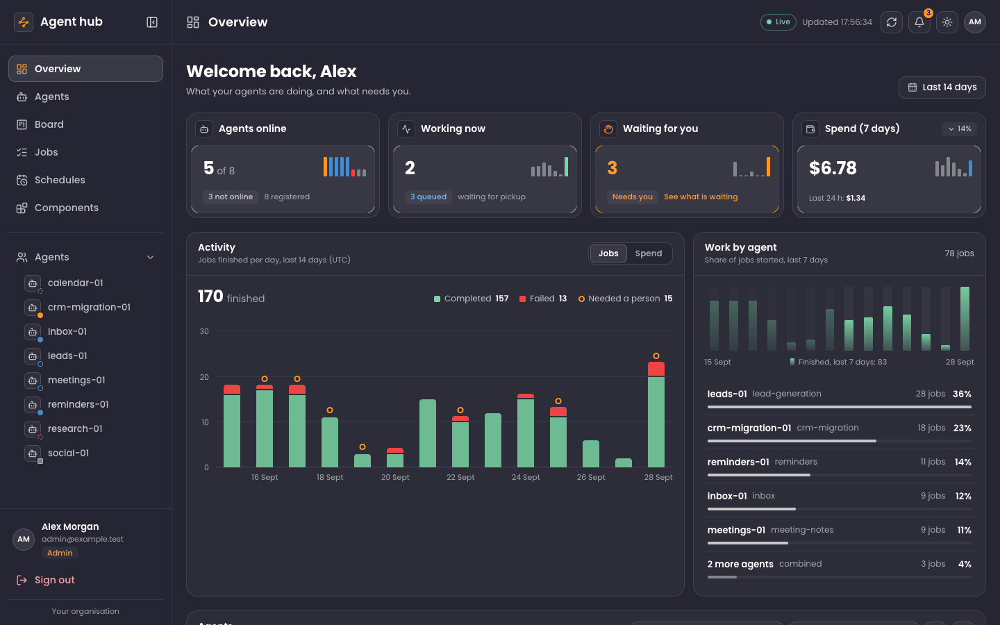
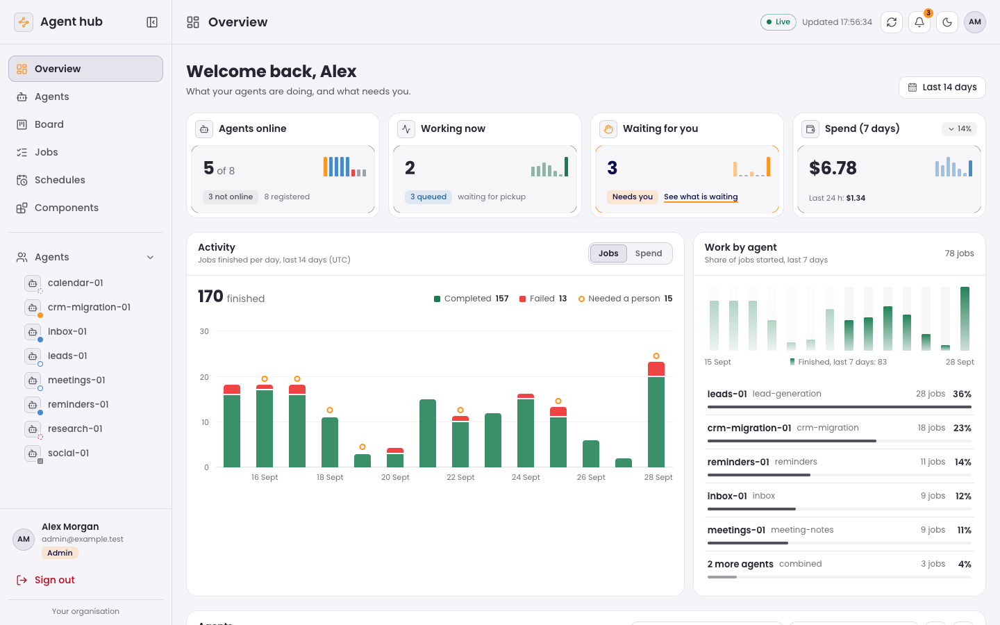

# template-hub

Next.js templates built with Tailwind CSS v4, dashboards and landing pages, each a standalone app with a dark and a light theme, ready to use as a boilerplate.

## Templates

### Agent hub

An operations dashboard for AI agents: stat cards with corner brackets, an activity chart, sortable tables that turn into cards on narrow screens, a kanban board, job drawers, schedules with switches, and a collapsible sidebar with a popover menu on phones.

| Dark | Light |
| --- | --- |
|  |  |

Every page, with screenshots of both themes: [agent-kernel](agent-kernel/README.md).

```bash
npx degit hendsuuu/template-hub/agent-kernel my-dashboard
```

## How the styles work

- **Two themes.** `data-theme="dark"` (the default) or `"light"` on `<html>`. Each template has a sun and moon button that switches it and remembers the choice, and a script in `<head>` applies it before the first paint.
- **Design tokens** (`brand.css`): colours, type, radii and shadows as a Tailwind v4 `@theme`, with a light value for every colour. Tailwind's default palette is switched off, so only the tokens exist as utilities (`bg-app`, `bg-panel`, `text-soft`, `text-quiet`, `border-line`, …). Surfaces are dark navy or white, orange is the one accent, status colours carry meaning only (green done, blue in progress, orange needs a person, red failed), and Poppins is the typeface. Every text colour clears 4.5:1 on every surface in both themes.
- **Component classes** (`agent-kernel.css`): every component as an `ak-*` class inside `@layer components`, so any Tailwind utility still overrides it. The classes only use the tokens, which is how one set of classes gives both themes.
- **Native interactivity** wherever it can be: the Jobs / Spend switch is a pair of radios read with `:has()`, chart tooltips are `:hover` and `:focus`, the phone menu is a popover, and tables become cards with container queries. Sorting, filtering, the sidebar collapse and dialogs are React.

## Maintaining

Each template is built and previewed in a separate workshop, kept outside this repository. The files a starter shares with the workshop (the design tokens, the stylesheet, the data and the components) are generated there by `npm run sync:starters`, and `npm run check:starters` fails when a starter has drifted, so change those files in the workshop, sync, then commit here. The screenshots come from `npm run screenshots -- <template>` in the workshop, run against the starter's production build.

## Credits

Icons are [Lucide](https://lucide.dev) (ISC).
