# Agent hub

An operations dashboard for AI agents, as a standalone Next.js 16 app (App Router, React 19, TypeScript, Tailwind CSS v4): who is online, what each agent is working on, what needs a person, and what runs on a schedule. Every page has a dark and a light theme, with mock data ready to swap for your own API.

| Dark | Light |
| --- | --- |
| 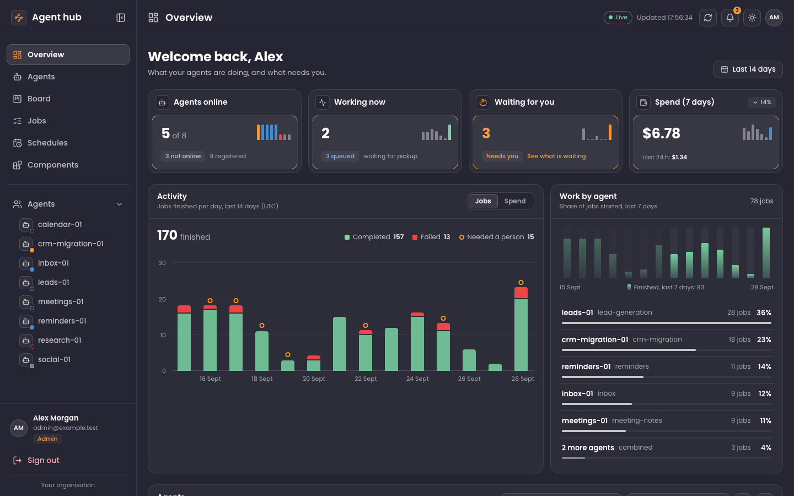 | 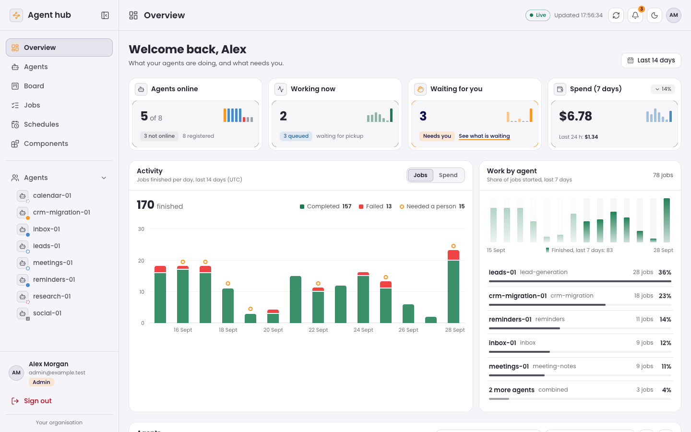 |

## Start a project

```bash
npx degit hendsuuu/template-hub/agent-kernel my-dashboard
cd my-dashboard
npm install
npm run dev
```

Open http://localhost:3000. `npm run build` makes a production build; `npm run typecheck` and `npm run lint` check the code.

## Pages

| Address | Page |
| --- | --- |
| `/` | Overview: stat cards, the activity chart (jobs or spend), work by agent, agents, recent jobs |
| `/agents` | Agents, with a search and status chips |
| `/board`, `/board/:jobId` | Kanban board, with a job's drawer over it (`?agent=` filters the board) |
| `/jobs`, `/jobs/:jobId` | Jobs, with the job drawer |
| `/schedules`, `/schedules/:jobId` | Schedules, with the last job's drawer |
| `/components` | Every component, with its classes |
| `/login` | Sign in |

| | Dark | Light |
| --- | --- | --- |
| Board | 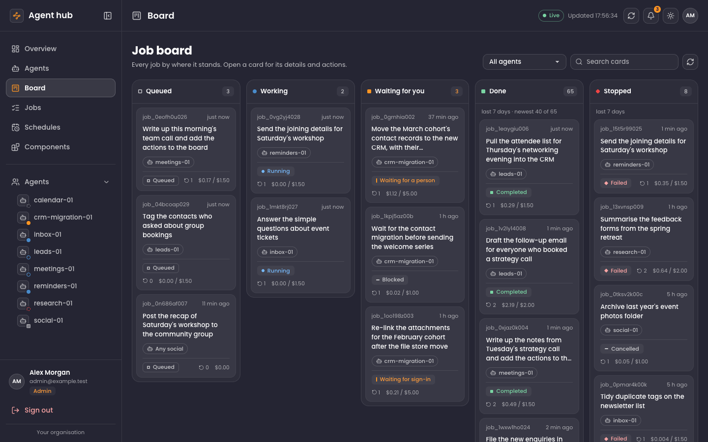 | 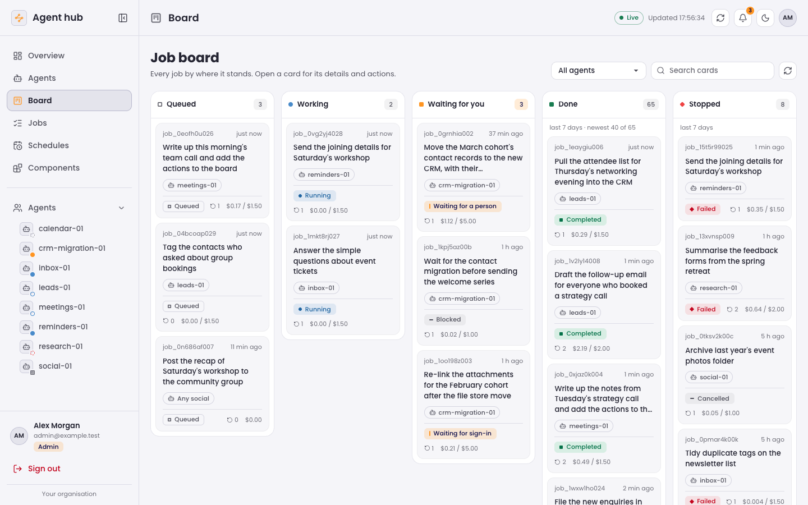 |
| Job drawer | 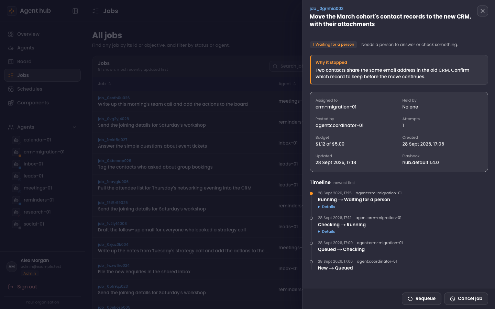 | 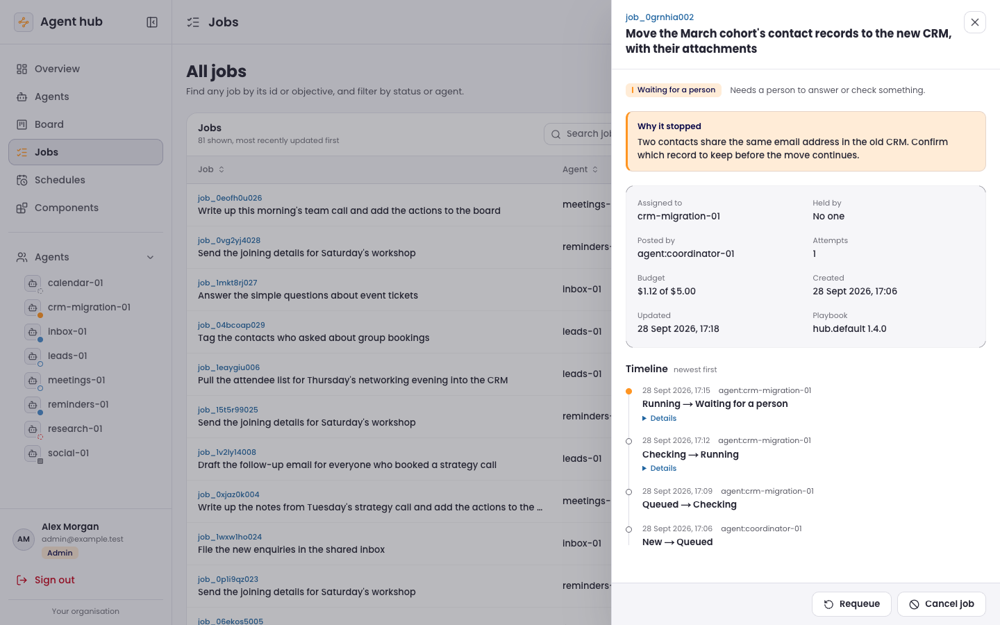 |
| Schedules | 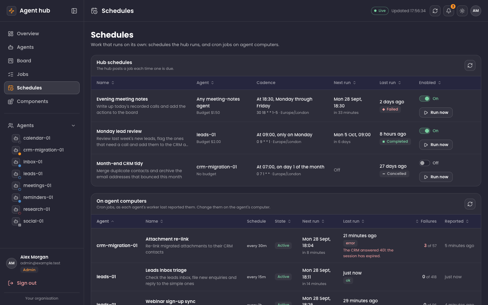 | 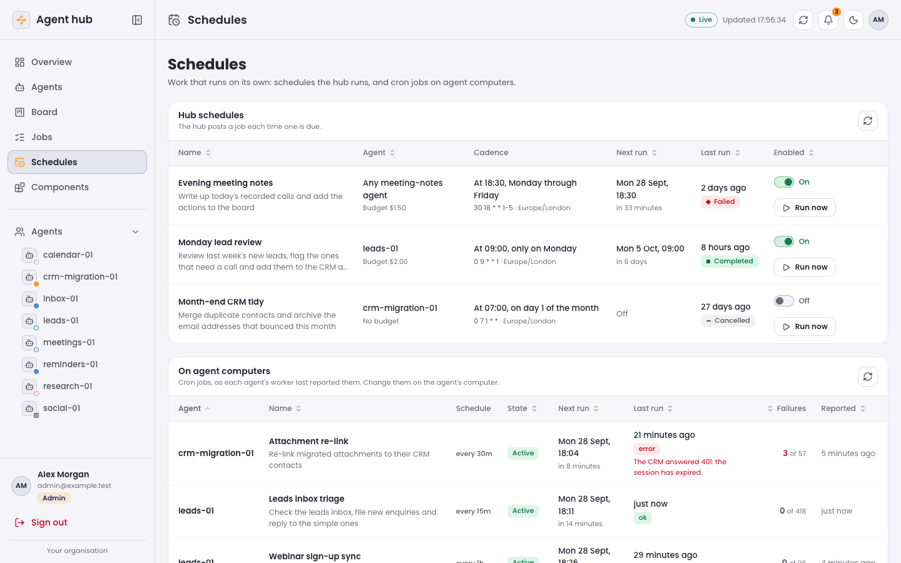 |
| Components | 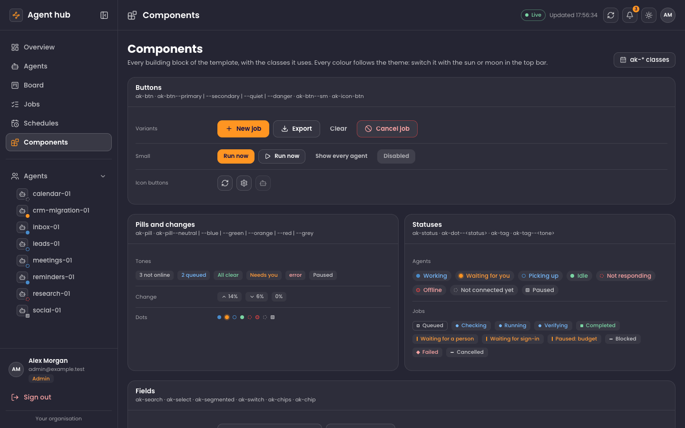 | 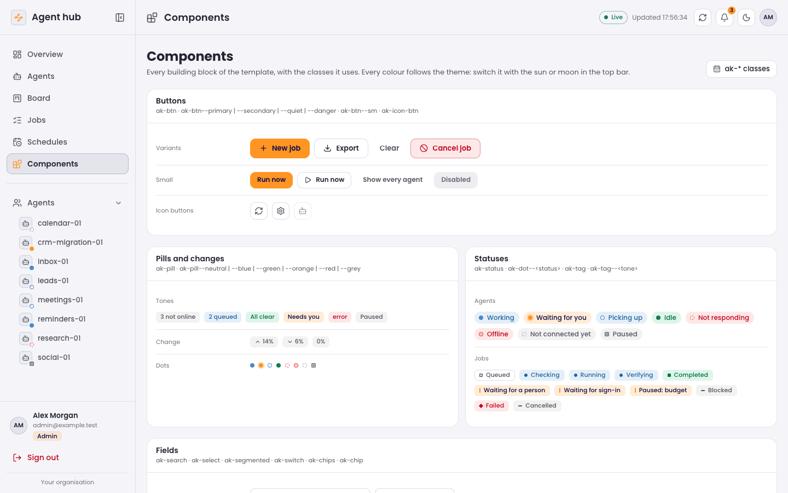 |
| Sign in | 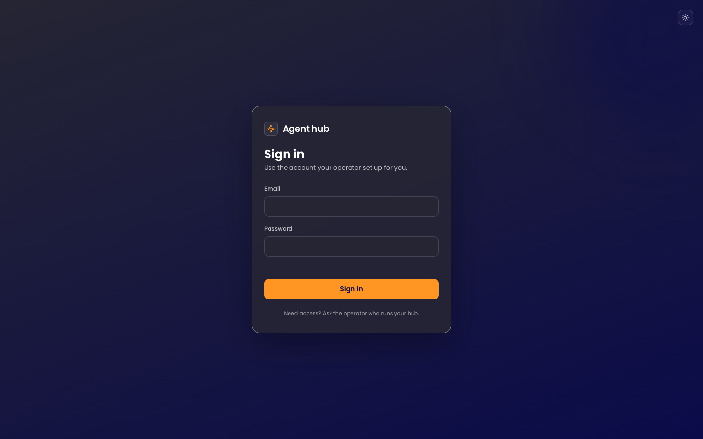 | 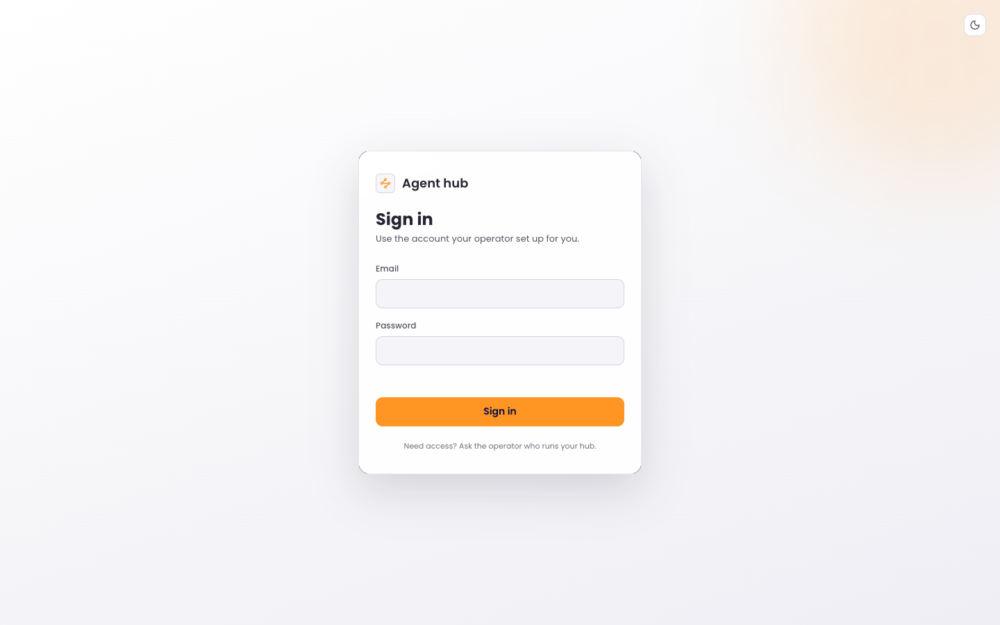 |
| Phone | 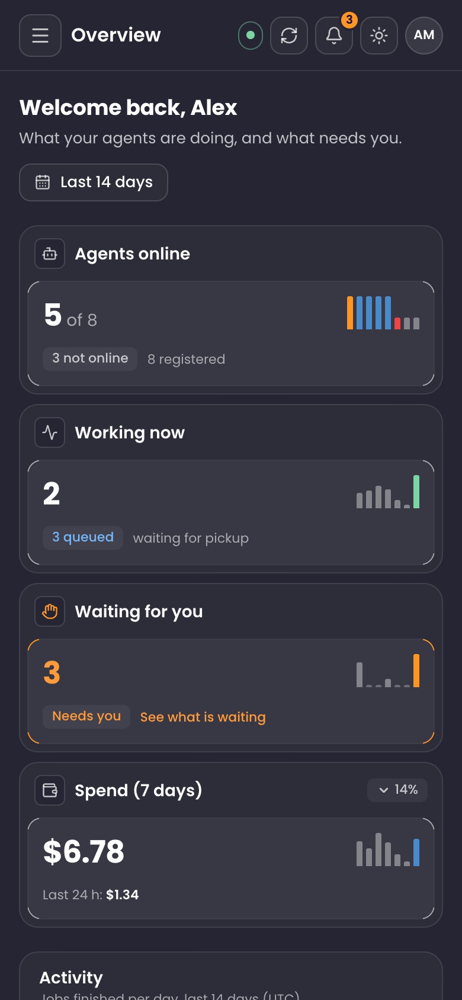 | 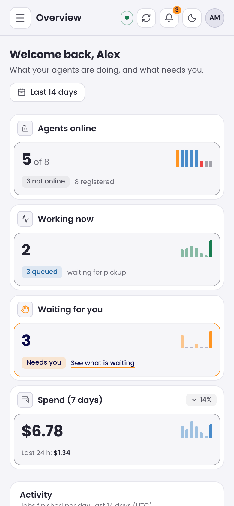 |

## Themes

The theme is `data-theme="dark"` or `"light"` on `<html>`. Dark is the default. The sun and moon button in the top bar (and on the sign-in screen) switches it and remembers the choice in `localStorage`, and a small script in `<head>` applies it before the first paint, so a page never flashes the wrong theme.

Every colour is a design token in `src/agent-kernel/brand.css`: the dark values in its `@theme` block, the light ones in `:root[data-theme="light"]`. Components only use the tokens, so a change there reaches every page in both themes. To start in the light theme, or to follow the system setting, change `THEME_SCRIPT` in `src/agent-kernel/layout/themeState.ts`.

## Layout

```
src/app/                  routes; the board, jobs and schedules layouts keep the list mounted while a drawer opens
src/app/layout.tsx        the document: font, the theme and sidebar script in <head>
src/app/globals.css       Tailwind, the design tokens and the template's classes
src/agent-kernel/         the template: components, layout, pages, lib, data
  brand.css               design tokens for both themes (Tailwind v4 @theme)
  agent-kernel.css        every component class (ak-*)
  layout/themeState.ts    the theme: the <head> script, reading and switching it
  components/ThemeToggle  the sun and moon button
  router.tsx              the router adapter: components import Link and the hooks from here
  paths.ts                every address
  lib/data.ts             the data functions: replace them with your API
```

## Using a component

```tsx
import { Panel } from "@/agent-kernel/components/Panel";
import { Pill } from "@/agent-kernel/components/Pill";

export function Example() {
  return (
    <Panel title="Queue" subtitle="Jobs waiting for an agent">
      <Pill tone="blue">3 queued</Pill>
    </Panel>
  );
}
```

The classes work on their own too: `<span class="ak-pill ak-pill--blue">3 queued</span>`.

## Keeping it in step

`src/agent-kernel/` and the routes in `src/app/` are generated from the template's source in the workshop, so change them there rather than here: see [Maintaining](../README.md#maintaining). Once you copy the starter out, it is yours to change.
